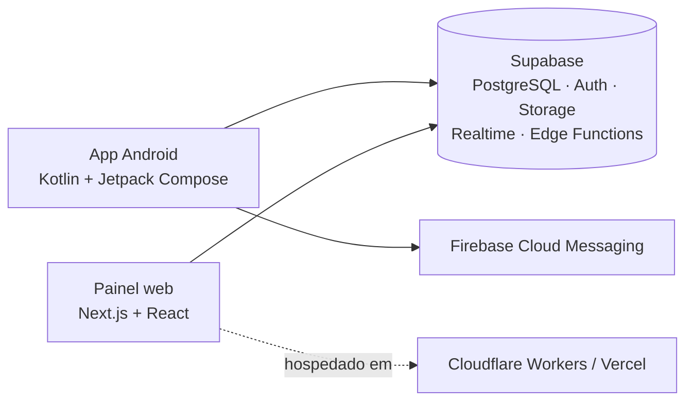

# Gestão para Psicólogos e Clínicas de Psicologia

> **Código fechado.** Este repositório é só uma apresentação do projeto: descreve o problema, as funcionalidades, as tecnologias e a arquitetura. O código-fonte é privado porque o sistema é um produto comercial.

## O problema

Muitos psicólogos e clínicas de psicologia controlam a agenda, os dados dos pacientes e os registros clínicos em planilhas, papel ou em várias ferramentas soltas. Isso dificulta o acompanhamento de cada paciente e deixa informações sensíveis espalhadas.

Este sistema junta tudo em um só lugar: um **app Android** e um **painel web**, os dois ligados ao mesmo backend.

## Funcionalidades

- **Agendamento de sessões**
- **Calendário semanal** com a visão da semana de atendimentos
- **Cadastro de pacientes**
- **Prontuário** de cada paciente
- **Anamnese**
- **Estudo de caso**
- Duas versões do app Android: uma completa (psicólogo e paciente) e uma só para o psicólogo
- Login com conta Google e bloqueio por biometria no app
- Notificações push

## Tecnologias

**App Android**
- Kotlin
- Jetpack Compose + Material 3
- Navigation Compose, ViewModel, DataStore, WorkManager
- Kotlinx Serialization + Ktor Client
- Supabase Kotlin (Auth, Postgrest, Storage, Realtime, Functions)
- Firebase Cloud Messaging (notificações)
- Credential Manager / Google Sign-In e Biometric
- Google Play Billing

**Painel web e site**
- TypeScript
- Next.js 15 + React 19
- Supabase JS
- Stripe

**Backend e infraestrutura**
- Supabase: banco PostgreSQL, autenticação, storage, realtime e Edge Functions
- Cloudflare Workers (via OpenNext) e Vercel para hospedagem do web
- GitHub para versionamento e publicação

## Arquitetura

O app Android e o painel web conversam com o mesmo backend no Supabase. O PostgreSQL guarda os dados de agenda, pacientes e registros clínicos, e o Supabase Auth cuida do login. O painel web é feito em Next.js e publicado na Cloudflare Workers com OpenNext.

## Telas

_Em breve: prints com dados fictícios._

## Autora

**Thamiris Schneider**: desenvolvedora Android e Full Stack
[LinkedIn](https://linkedin.com/in/thamiris-schneider) · [Portfólio](https://thssxhm.lovable.app) · thssxhm@gmail.com
